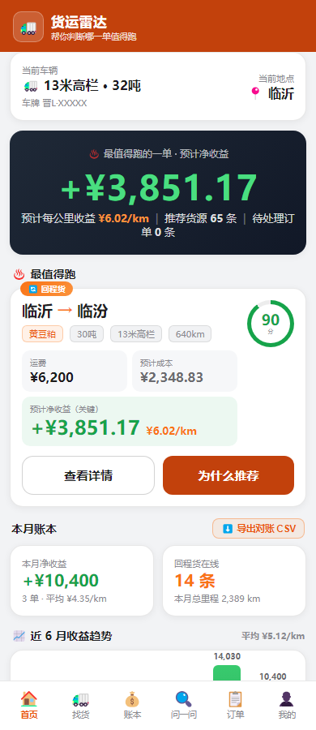
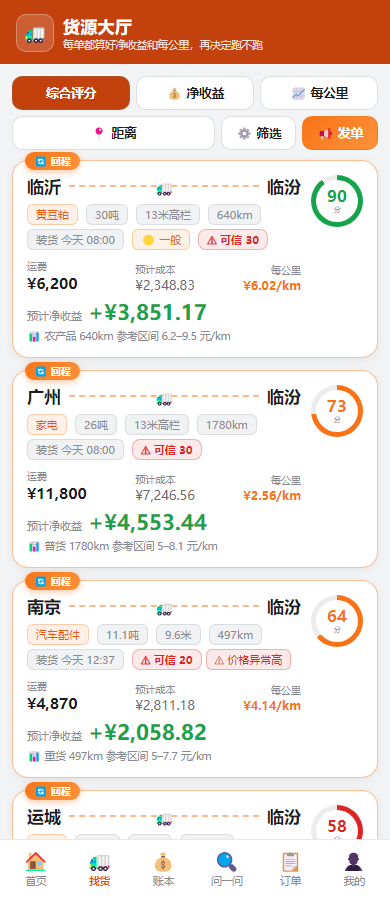
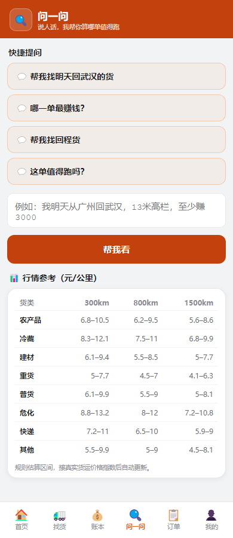

# 🚛 货运雷达 · Freight Radar

面向个体大货车司机的 **AI 货运决策系统** —— 帮司机判断"哪一单更值得跑"。

> 核心闭环：找货 → 算成本 → 算净收益 → 算每公里收益 → 综合评分 → AI 推荐 → 找回程货 → 记录结果 → 形成历史 → 个性化推荐
>
> 文档入口：[AGENTS.md](AGENTS.md)（协作契约）｜[docs/README.md](docs/README.md)（文档索引）｜[docs/PRD.md](docs/PRD.md)（需求与优先级）｜[docs/验收标准.md](docs/验收标准.md)（验收判定）

## 界面预览

| 首页 · 今天最值得跑的一单 | 货源大厅 · 成本 / 净收益 / 评分 | 问一问 · 一句话找货 |
| --- | --- | --- |
|  |  |  |

> 截图取自真实运行实例（DeepSeek 官方 API + 高德真实路线），按手机尺寸 390×900 截取。

---

## 一、项目定位

不是"货源信息展示网站"，而是**决策系统**：

| 对比项 | 普通货源 App | 货运雷达 |
| --- | --- | --- |
| 货源展示 | 只给运费和路线 | 运费 + **预计成本 + 预计净收益 + 每公里收益 + AI 评分** |
| 判断依据 | 司机自己心算 | 确定性业务计算 + 加权评分（收益40/路线20/回程20/车型10/时间10） |
| AI 角色 | 聊天机器人 | **自然语言理解 + 推荐解释**（不参与计算、不虚构数据） |
| 回程货 | 手动找 | 自动标记 + 回程方向加权优先 |
| 数据演进 | 静态 | 数据访问层接口，Mock → 真实 API 无缝切换 |

## 二、技术栈

- **语言**：TypeScript（严格模式，类型安全）
- **后端**：Node.js + Express（纯业务逻辑，无 ORM 依赖）
- **测试**：Vitest（`npm test` 25 个测试文件 / 281 个用例，覆盖成本计算/评分/过滤/AI 编排/API；
  数字以 `npm test` 实际输出为准）
- **运行**：tsx（开发热重载）；`npm run build` 可产出纯 JS

## 三、快速开始

```bash
npm install
npm run dev        # 启动 API → http://localhost:3000（默认内存 Mock，重启丢数据）
npm test           # 运行全部测试
npm run typecheck  # 类型检查
```

**持久化模式**（推荐，重启不丢数据）：
```bash
PERSIST=sqlite npm run dev     # SQLite（Node 内置 node:sqlite，推荐，支持多司机）
PERSIST=json npm run dev       # JSON 文件（兼容旧版）
PERSIST=1 npm run dev          # 等价于 sqlite
PERSIST=1 DATA_DIR=/my/data npm run dev   # 自定义数据目录
```

**高德真实数据**（免费 Key：https://lbs.amap.com → 应用管理 → Web服务）：
```bash
AMAP_KEY=你的key PERSIST=1 npm run dev
```

**真实大模型（DeepSeek 官方 API）**：AI 助手用真实大模型解析需求 + 生成推荐解释（金额/评分仍由后端确定性计算，LLM 不参与）：
```bash
export DEEPSEEK_API_KEY="sk-你的key"   # https://platform.deepseek.com/api_keys
export DEEPSEEK_MODEL="deepseek-flash"  # 要更强推理可换 deepseek-v4-pro
PERSIST=1 npm run dev
```
> 直连 `https://api.deepseek.com`，不经过火山方舟等中间层，key 和账单都在 DeepSeek 平台自己手里。不配 key 时自动回退规则引擎，功能完整、0 消耗。
> 换厂商零改动：只要目标是 OpenAI 兼容的 `/chat/completions`，实现 `LlmPort` 即可（见 `src/ai/selectLlm.ts`）。

**Docker 部署**：
```bash
docker build -t freight-radar .
docker run -p 3000:3000 -e AMAP_KEY=xxx -e DEEPSEEK_API_KEY=sk-xxx -e PERSIST=1 -v fr-data:/app/data freight-radar
```

环境变量见 `.env.example`。

### 部署上线（公网 / 局域网）

- 🌐 **公网上线（免域名免备案，约 ¥70–100/年）**：见 `deploy\阿里云部署步骤.md`；
  服务器上一条命令搞定（装 Docker → 拉代码 → 起服务 → 自检）：
  `bash <(curl -fsSL https://gitee.com/clove28/freight-radar/raw/main/deploy/bootstrap.sh)`
- 🏠 **局域网先给老爸用（零成本）**：见 `deploy\局域网使用方案.md`（同 WiFi 手机访问）
- ⚠️ 免责声明：`deploy\免责声明.txt`（上线必备）
- 一键启动（含 DeepSeek/高德/SQLite 全部 key，读 `.env`）：`start.ps1`

### 前端（P1 移动端产品层）

```bash
cd web
npm install
npm run dev        # Vite 开发服务器 → http://localhost:5173（代理 /api 到 3000）
npm run build      # 产出 web/dist，后端自动托管
```

**访问方式**：后端已托管前端构建产物，直接打开 `http://localhost:3000/` 即可使用完整产品
（先 `cd web && npm run build` 生成页面）。移动端底部导航：首页 / 找货 / AI助手 / 订单 / 我的。

### API 一览

| 方法 | 路径 | 说明 |
| --- | --- | --- |
| GET | `/api/health` | 健康检查 |
| GET | `/api/dashboard` | 首页聚合：车辆/城市/AI Top1+Top3/今日本月收益/回程状态/订单数 |
| GET | `/api/cargos` | 货源大厅：评分排序 + 条件过滤（from/to/truck/cargo/运距/收益下限/回程）|
| GET | `/api/cargos?sort=` | 排序：`ai`(默认) / `netIncome` / `perKm` / `distance` |
| POST | `/api/cargos` | 手动发单（P17 车队互助货源池，需登录态字段校验） |
| GET | `/api/cargos/:id` | 货源详情（成本拆解 + 评分分解） |
| GET | `/api/cargos/:id/explain` | 单货源 AI 解释（"为什么推荐"） |
| GET/POST | `/api/cargos/:id/feedback` | 卡友反馈：查看 / 提交（装货等待、装卸难易） |
| POST | `/api/assistant` | AI 助手：自然语言 → 推荐 + 解释 |
| GET | `/api/vehicle` | 车辆档案 |
| PUT | `/api/vehicle` | 更新车辆档案（编辑后所有计算用新参数） |
| GET/PUT | `/api/prefs` | 司机底线偏好（每公里/单趟最低净收益、最大运距） |
| GET | `/api/orders` | 订单列表 |
| POST | `/api/orders` | 接单（`{loadId}`，货源自动置 taken） |
| GET | `/api/orders/:id` | 订单详情 |
| POST | `/api/orders/:id/steps/:stepId` | 完成证据链一步 |
| POST | `/api/orders/:id/loss` | 损耗对比（`{loadTons, unloadTons}`） |
| GET | `/api/orders/:id/pack` | 生成/查看证据包 |
| GET | `/api/service-fee/balance` | 平台服务费余额（虚拟额度，不可提现/转账） |
| POST | `/api/service-fee/recharge` | 演示充值虚拟额度（P11） |
| GET | `/api/credits` | 货主信用（P3） |
| POST | `/api/credits/rate` | 评价货主（`{owner, level: good/medium/bad, tags?, comment?}`） |
| POST | `/api/credits/:owner/unblacklist` | 移出黑名单 |
| GET | `/api/history` | 历史画像（常跑线路/平均每公里/完成率/超损率） |
| GET | `/api/stats` | 数据统计：月度收益趋势/线路分布/每公里均值（P10） |
| GET/POST | `/api/books` | 记账：列表/记一笔（P11，支持 km 里程字段） |
| PATCH/DELETE | `/api/books/:id` | 更新（km 补录）/删除一笔账（P12） |
| GET | `/api/export/books.csv` | 收益报表 CSV 导出（P11，司机对账，带 BOM 兼容 Excel，含每公里收益列） |
| GET | `/api/export/books.html` | 收益报表 HTML（P15，自包含中文无损，浏览器打开即可打印/存 PDF） |
| GET | `/api/route/strategies` | 路线策略选项（P4） |
| GET | `/api/route/environment?from&to&strategy` | 路线环境全景：路径/天气影响/补给点（P4） |
| GET | `/api/route/compare` | 多策略路线对比（P4） |
| GET | `/api/events` | SSE 实时推送：匹配回程/常跑的新货源提醒（P6，兼容保留） |
| WS | `/api/ws` | WebSocket 实时推送：双向订阅（P7，`{type:'subscribe', backhaulOnly:true}`） |
| GET/POST | `/api/drivers` | 多司机账号：列表/创建（P6，需 SQLite 模式） |
| POST | `/api/drivers/:id/switch` | 切换当前司机（P6） |
| POST | `/api/auth/register` | 注册（`{name, password}`，密码 scrypt 哈希，P7） |
| POST | `/api/auth/login` | 登录 → `{token, driver}`（P7） |
| GET | `/api/auth/me` | 当前登录态（`Authorization: Bearer <token>`，P7） |
| POST | `/api/auth/logout` | 登出（P7） |
| POST | `/api/auth/sms/send` | 发送手机验证码（P8，演示环境直接返回 devCode；P9 限流 60s/次·每小时5次） |
| POST | `/api/auth/sms/login` | 验证码登录（P8，首次自动建档） |
| POST | `/api/auth/scan/create` | 创建扫码登录会话（P9，模拟微信扫码，预留真实接入） |
| GET | `/api/auth/scan/status` | 轮询扫码状态（P9） |
| POST | `/api/auth/scan/approve` | 模拟手机端确认扫码（P9） |
| POST | `/api/sync/upload` | 多端同步上传（订单/信用/记账，需登录，P8） |
| GET | `/api/sync/download` | 多端同步下载（P8） |
| GET | `/api/quote?cls=普货&km=500` | 行情区间（P7） |

示例：
```bash
curl -X POST http://localhost:3000/api/assistant \
  -H "Content-Type: application/json" \
  -d '{"text":"我明天从广州回武汉，13米高栏，至少赚3000"}'
```

## 四、目录结构

```
货运雷达/
├── src/
│   ├── core/               # 纯业务逻辑（无框架依赖，可独立测试）
│   │   ├── types.ts        #   领域类型：Cargo/Vehicle/Cost/Score...
│   │   ├── constants.ts    #   评分权重、阈值、损耗标准
│   │   ├── cost.ts         #   成本计算引擎（支持空驶/策略/天气系数注入）
│   │   ├── scoring.ts      #   综合评分 + 过滤 + 排序（支持成本选项回调）
│   │   ├── order.ts        #   订单/证据链/损耗对比/证据包/价格异常检测（P2）
│   │   ├── credit.ts       #   货主信用：三档评价/黑名单/徽标/降权（P3）
│   │   ├── history.ts      #   历史画像：常跑线路/完成率/超损率（P3）
│   │   ├── routePlanner.ts #   空驶里程规划：Mock估算/高德真实（P3）
│   │   ├── weather.ts      #   天气影响：油耗/胎压/气耗建议（P4）
│   │   └── routeStrategy.ts#   路线策略：高速/国道/平衡 → 系数（P4）
│   ├── data/               # 数据访问层（Mock ↔ 文件持久化 ↔ 真实 API 可切换）
│   │   ├── repository.ts   #   仓储接口（Cargo/Vehicle/Book/Order/Prefs/Credit/RoutePlanner）
│   │   ├── seed.ts         #   种子数据（固定种子，可复现）
│   │   ├── mock.ts         #   Mock 实现（内存态）
│   │   ├── fileRepository.ts#   JSON 文件持久化（P5，PERSIST=1 启用）
│   │   ├── apiRepository.ts#   真实货源 API 仓储（P3，CARGO_SOURCE=api 切换）
│   │   └── amap.ts         #   高德客户端：地理编码/路径规划/天气/POI（P4）
│   ├── ai/                 # AI 编排（LLM 只理解与解释，不计算）
│   │   ├── llm.ts          #   LLM 端口接口 + 提示词模板
│   │   ├── ruleLlm.ts      #   规则版实现（阶段一，零外部依赖）
│   │   └── assistant.ts    #   推荐流程编排（核心闭环）
│   └── server/             # HTTP 层
│       ├── app.ts          #   Express 应用与路由（含前端静态托管）
│       ├── services.ts     #   应用服务（Dashboard/详情/推荐/排序/车辆编辑）
│       └── index.ts        #   入口
├── web/                    # P1 前端（React + Vite + TS，移动端优先）
│   ├── src/
│   │   ├── api/            #   API 客户端（唯一网络出口）+ DTO 类型
│   │   ├── components/     #   通用组件（CargoCard/ScoreRing/状态组件）
│   │   ├── pages/          #   Dashboard/货源大厅/详情/AI助手/订单/我的车辆
│   │   ├── utils/format.ts #   纯展示格式化
│   │   └── App.tsx         #   路由 + 底部导航
│   └── vite.config.ts      #   开发代理 /api → :3000
└── tests/                  # Vitest 单元/集成测试（文件清单见「八、测试」）
```

## 五、核心业务逻辑

### 成本计算（`src/core/cost.ts`，确定性公式，LLM 不参与）

```
油费     = 总里程 / 100 × 百公里油耗 × 油价
高速费   = 总里程 × 每公里高速费系数
其他费用 = 车辆档案固定杂费（食宿/停车/装车）
空驶成本 = 空驶里程 / 100 × 百公里油耗 × 油价（去装货地的空驶，Mock 取运距15%）
总成本   = 油费 + 高速费 + 其他费用 + 空驶成本
净收益   = 运费 − 总成本
每公里净收益 = 净收益 / 总行驶里程
```

### 综合评分（`src/core/scoring.ts`）

| 维度 | 权重 | 规则 |
| --- | --- | --- |
| 收益 | 40% | 每公里净收益 ≥8 元满分，≤0 零分，线性 |
| 路线匹配 | 20% | 命中常跑路线 100；仅目的地相同 55；无 25 |
| 回程概率 | 20% | 目的地∈回程基地城市 100；否则 20 |
| 车型匹配 | 10% | 车型匹配 100；不匹配 20 |
| 时间匹配 | 10% | 装货时间越近分越高（6h/24h/72h → 100/70/45） |

### AI 推荐流程（`src/ai/assistant.ts`）

```
用户自然语言输入
  → LlmPort.parseRequest       # LLM 只做理解；默认规则引擎，配 key 走 DeepSeek
  → CargoRepository.listAll    # 查真实/Mock 数据（禁止凭空生成）
  → filterCargoes              # 业务代码过滤（车型/载重/回程/运距/收益下限）
  → calcCost + scoreCargo      # 业务代码计算成本与评分（与大厅同口径 costFor）
  → rankCargoes 取 Top N       # 业务代码排序
  → LlmPort.explain            # LLM 基于真实结果组织解释（不编造数字）
```

## 六、AI 边界（重要设计原则）

- ✅ AI 负责：自然语言理解、需求结构化、推荐解释、决策辅助
- ❌ AI 不负责：计算油费/成本/净收益/评分/排序（全部业务代码完成）
- ❌ AI 不虚构：货源、运费、里程、收益（全部来自数据层）

默认用 `RuleBasedLlm`（规则解析，零配置、测试确定）；配置 `DEEPSEEK_API_KEY` 后由 `selectLlm` 切到 DeepSeek 官方（失败/超时自动回退规则引擎），业务层只依赖 `LlmPort`，换厂商零改动。

## 七、数据访问层（Mock → 真实 API）

`src/data/repository.ts` 定义仓储接口，`mock.ts` 提供内存实现（固定种子、可复现）。
接入真实货源 API（如运满满开放平台）时：

1. 新建 `ApiCargoRepository implements CargoRepository`
2. 在 `createApp` 里替换注入
3. 业务层（评分/推荐/API）零改动

## 八、测试

```bash
npm test
```

> 下表由 `tests/docs.test.ts` 校验：新增测试文件必须在此登记，否则 `npm test` 会失败。
>
> 发布 / 阶段验收的完整判定标准（UAT 场景、非功能门、上线门、一票否决）见 [`docs/验收标准.md`](docs/验收标准.md)。

| 文件 | 覆盖 |
| --- | --- |
| `tests/cost.test.ts` | 成本公式、载重约束、车型匹配 |
| `tests/scoring.test.ts` | 各分项评分、过滤、排序、topN |
| `tests/assistant.test.ts` | 自然语言解析、推荐闭环、解释真实性 |
| `tests/api.test.ts` | 全部路由、错误处理（400/404/500） |
| `tests/order.test.ts` | 订单/证据链/损耗公式/证据包/价格异常 |
| `tests/order-api.test.ts` | 接单闭环、底线过滤、Dashboard 同步 |
| `tests/cargoFeedback.test.ts` | 货源反馈核心判定、Mock 仓储 |
| `tests/credibility.test.ts` | 货源完整度、可信度评分、时效惩罚（注入 `now`） |
| `tests/serviceFee.test.ts` | 服务费核心纯函数、虚拟服务额度 |
| `tests/p3.test.ts` | 货主信用规则、历史画像、空驶规划、真实 API 仓储（超时/异常/空数据） |
| `tests/p4.test.ts` | 天气影响规则、路线策略系数、成本修正、高德回退 |
| `tests/p5.test.ts` | JSON 文件持久化、行情价格异常、中途天气 |
| `tests/p6.test.ts` | 行情抽象 QuoteProvider（契约可替换） |
| `tests/p7.test.ts` | 密码哈希（scrypt/盐/恒时比较）、行情参数 |
| `tests/p8.test.ts` | 会话 TTL、手机号/验证码规则 |
| `tests/p9.test.ts` | 扫码登录状态机、短信限流窗口 |
| `tests/p10.test.ts` | 统计模块（月度/线路）、登录锁定、密码强度 |
| `tests/p11.test.ts` | 账本里程、CSV 导出、Provider 抽象 |
| `tests/p12.test.ts` | CSV 每公里收益列 |
| `tests/p13.test.ts` | 月度汇总字段 |
| `tests/p14.test.ts` | LLM 接入：JSON 解析容错、字段白名单、失败回退规则引擎、DeepSeek 官方优先于火山兼容配置 |
| `tests/p15.test.ts` | HTML 报表、分页切片逻辑 |
| `tests/p16.test.ts` | 货主信用排序 |
| `tests/docs.test.ts` | README 测试清单与 `tests/` 目录一致性（防文档漂移） |
| `tests/rate-limit.test.ts` | 演示环境成本闸门：单 IP 每分钟上限、全站每日上限、跨天重置、参数收敛 |
| `tests/sqlite.integration.mjs` | SQLite 能力集成测试（`npm run test:sqlite`，Node 原生 runner） |

## 九、状态与路线图

- [x] **P0 核心引擎**：TS 工程 + 成本/评分/过滤 + 数据访问层 + AI 编排 + API + 测试
- [x] **P1 移动端产品层**：React 前端（Dashboard/货源大厅/详情/AI助手/订单/我的车辆）+ 底部导航 + Loading/Empty/Error 状态 + 车辆编辑
- [x] **P2 订单与决策增强**：订单模块（接单→证据链8步→损耗对比→证据包）+ 司机底线偏好 + 价格异常检测 + 前端订单列表/详情页
- [x] **P3 信用与个性化**：货主信用（👍+1/0/👎−3→黑名单，徽标+降权）+ 真实货源 API 仓储（可切换+超时/异常/空数据）+ 历史画像反哺 + 空驶里程真实化
- [x] **P4 路线与环境**：高德客户端（路径规划/天气/POI，AMAP_KEY 可配，无 key 回退 Mock）+ 路线策略（高速/国道/平衡→toll/油耗/时长系数，注入成本计算）+ 天气影响规则（雨雪/低温/高温/大风→油耗修正+胎压建议+降速提醒，含天然气气耗）+ 沿途补给点 + 详情页"路线与环境"区块
- [x] **P5 持久化与决策增强**：JSON 文件持久化（PERSIST=1，重启不丢数据，原子写）+ 路线偏好记忆（详情页选策略自动记住，成本计算默认用）+ 沿途多段天气（出发/中途/目的）+ 行情价格异常（按货类/里程区间替代固定阈值，卡片显示参考区间）+ Docker 部署 + .env.example
- [x] **P6 持久化升级与账号**：SQLite 仓储（Node 内置 node:sqlite，PERSIST=sqlite，并发安全+按司机隔离）+ 多司机账号（创建/切换，车辆/偏好独立，前端"我的"页管理）+ SSE 实时推送（匹配回程/常跑货源即时提醒）+ 行情数据源抽象（QuoteProvider 接口，未来可换真实行情 API）
- [x] **P7 登录与实时通道**：司机登录鉴权（scrypt 密码哈希+盐+恒时比较，token 会话存 SQLite，注册/登录/登出/me API，前端登录页+免登录演示入口）+ WebSocket 双向推送（/api/ws，客户端可订阅过滤如"只收回程"，与 SSE 并存）+ 行情指数 API（/api/quote）
- [x] **P8 账号安全与多端同步**：会话 TTL（7 天过期）+ 手机号验证码登录（演示环境返回 devCode，生产接短信服务商）+ 鉴权中间件（AUTH_REQUIRED=1 开启，白名单放行 auth/health/events，其余需 Bearer token，前端自动附带）+ 多端同步 API（订单/信用/记账上传下载）+ 微信小程序云同步页（登录+上传/下载）+ Nginx/TLS 部署示例
- [x] **P9 登录体验与安全**：扫码登录（状态机 pending→approved→expired，TTL 120s，前端二维码+轮询+模拟手机确认，预留真实微信接入）+ 短信限流（60s/次、每小时 5 次，429 响应）+ 启动会话/验证码清理 + 请求日志（LOG_REQUESTS=1）+ 上线检查清单
- [x] **P10 数据可视化与安全**：统计模块（月度收益趋势/线路分布/每公里均值，`/api/stats`）+ Dashboard 收益柱状图与线路条形图（纯 CSS 零依赖）+ 登录失败锁定（连续 5 次锁 10 分钟，423 响应）+ 密码强度（≥6 位含数字）+ 演示真实货源 API（`examples/mock-cargo-api.mjs`，CARGO_SOURCE=api 全链路验证含故障注入）
- [x] **P11 数据精确与对账**：记账 km 里程字段（BookEntry 可选 km，统计/每公里收益优先真实值，兜底估算）+ 收益报表 CSV 导出（`/api/export/books.csv`，Excel 兼容 BOM，Dashboard 一键下载）+ 短信服务商 Provider 抽象（DevSmsProvider 演示 / AliyunSmsProvider 骨架，SMS_PROVIDER 切换）+ 行情 API Provider 骨架（QUOTE_API_URL 切换）+ docker-compose 一键部署（含安全/高德/短信/行情环境变量）
- [x] **P12 收益账本页**：前端账本页（月度汇总 + 记一笔表单含 km + 明细列表 + km 补录 + 删除，底部导航新增"账本"）+ 记账 CRUD API（PATCH/DELETE）+ CSV 加每公里收益列
- [x] **P13 账本增强与容错**：账目整条编辑（PUT /api/books/:id + 前端编辑模式）+ 月度汇总补全（本月运费/成本/里程）+ 打印/存PDF（@media print 样式 + 账本页打印按钮）+ 高德失败自动降级（key 无效/超时回退 Mock，不再报错）
- [x] **P14 真实 LLM 接入**：火山方舟 DeepSeek LLM（OpenAI 兼容协议 ArkLlm 实现，ARK_API_KEY/ARK_MODEL 配置，JSON 解析容错 + 字段白名单 + 请求失败自动回退规则引擎；AI 助手用真实大模型理解需求与生成推荐解释，金额/评分仍由后端确定性计算）+ 模型探测（发现已开通的 deepseek-v4-pro-ga-260813，旧 v3/r1 已下线）+ docker-compose/README 固化了配置
- [x] **P15 报表与多端**：收益报表 HTML 导出（`/api/export/books.html`，自包含中文无损，浏览器打开即可打印/存 PDF）+ 货源 API 分页（page/limit）+ AI 引擎前端徽标（🔴 DeepSeek·V4 / ⚪ 规则引擎，一眼确认接入）+ 火山方舟模型探测（发现 deepseek-v4-pro-ga-260813）+ LLM 调用日志 + 小程序云端货源模式（从后端 /api/cargos 拉真实评分货源，卡片显示净收益/每公里/评分，后端不可达自动回退本地 mock）+ LLM 省 token 模式（不带 ARK_API_KEY 即规则引擎 0 消耗）
- [x] **P16 高德真实数据 + 货主信用管理**：高德 API 接入（真实路线规划 971km/过路费/导航步骤 + 真实天气改用 adcode + 真实沿途加油站/餐馆，AMAP_KEY 可配无 key 回退 Mock）+ 货主信用管理页（`/credits`：列出全部货主评分/好坏差/黑名单/标签/备注，可评价（👍+1/0/👎−3+标签+备注）、移出黑名单，从"我的"页入口进入）
- [ ] **P17 真实化冲刺**：真实货源 API、短信/行情 Key 接入、微信扫码、HTTPS 正式部署、小程序真机联调、服务端 PDF 报表

> 需求来源、优先级理由与 P17 逐项 DoD 见 [docs/PRD.md](docs/PRD.md)；本列表只保留状态。

> 旧演示蓝本（`卡友助手.html`、`小程序版/`）当前不在本仓库、也不在 `D:\字研班` 工作区；
> 本仓库是唯一落地实现，不要按旧路径找文件。

## 🔑 高德 API 配置（P4 真实数据）

免费申请：高德开放平台 → 控制台 → 应用管理 → 创建"Web服务"类型 Key。

```bash
AMAP_KEY=你的key npm run dev
```

配置后自动生效：真实驾车里程/时长/过路费、城市实时天气、周边加油站/餐馆。
未配置时回退 Mock（城市距离 + 模拟天气），演示与测试不受影响。

## 十、合规与说明

- 阶段一全部为 Mock 数据，不涉及真实运输业务
- 货运信息撮合规模化前需了解《网络平台道路货物运输经营管理暂行办法》
- 联系电话为模拟号，仅用于演示
